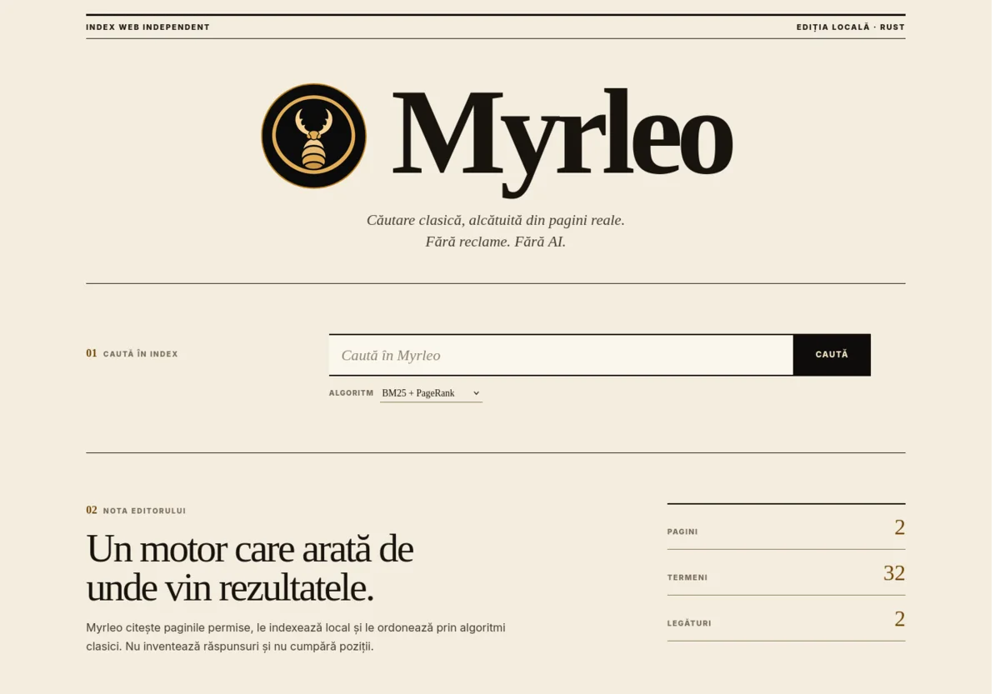

# Myrleo

<p align="center">
  
</p>

<p align="center">
  <strong>A classical web search engine built from scratch in Rust.</strong><br>
  No ads. No AI-generated answers. No paid rankings.
</p>



Myrleo is an educational, independent search engine that crawls public web
pages, builds a positional index, and ranks results with classical information
retrieval algorithms. Its visual identity uses a contemporary newspaper layout
and a black, gold, and cream color palette.

> **Project status:** functional MVP. Myrleo is ready for local experiments and
> portfolio demonstrations, but it is not yet designed to index the entire web
> or handle production-scale traffic.

## Highlights

- BFS web crawler;
- `robots.txt` support;
- configurable page, depth, request-delay, and response-size limits;
- HTML title, text, and link extraction;
- SQLite persistence with a positional inverted index;
- TF, TF-IDF, and BM25 ranking;
- PageRank over the crawled link graph;
- Boolean queries with `AND`, `OR`, `NOT`, and parentheses;
- exact phrase search;
- Trie-based autocomplete;
- spelling correction using Levenshtein distance and a BK-tree;
- responsive Axum web interface;
- automated Rust tests and strict Clippy checks.

The original Python prototype is preserved in `prototype_python/` for
educational purposes. The main application is written in Rust.

## Architecture

```text
Public websites
      │
      ▼
BFS crawler ── robots.txt, limits, politeness delay
      │
      ▼
HTML parser ── title, visible text, outgoing links
      │
      ├──────────────► Link graph ──► PageRank
      │
      ▼
Tokenizer ──► Positional inverted index ──► SQLite
                                              │
User query ──► Boolean / TF / TF-IDF / BM25 ─┘
      │
      ▼
Axum web interface or CLI results
```

## Requirements

- a recent stable Rust toolchain;
- Cargo;
- Python 3 only for the optional local test website.

## Build and test

```bash
cargo build
cargo test
cargo clippy --all-targets -- -D warnings
```

## Crawl a website

Start with a small public website that you are allowed to crawl:

```bash
cargo run -- crawl https://example.com \
  --max-pages 20 \
  --max-depth 2 \
  --delay-ms 1000
```

The crawler remains on the seed domain and accepts HTML pages only. It does
not index images, videos, archives, or PDF files. The default database is
`myrleo.db`.

You can run the command multiple times with different domains. Every crawl is
added to the same database.

## Search from the CLI

BM25 with a PageRank bonus is the default ranking mode:

```bash
cargo run -- search "rust search engine"
```

Compare the available algorithms:

```bash
cargo run -- search "rust fast" --algorithm tf
cargo run -- search "rust fast" --algorithm tf-idf
cargo run -- search "rust AND (fast OR safe)" --algorithm boolean
cargo run -- search "rust AND NOT slow" --algorithm boolean
cargo run -- search "classical search engine" --algorithm phrase
```

Autocomplete and spelling correction:

```bash
cargo run -- suggest sea
cargo run -- correct serach --max-distance 2
```

Use a different database file:

```bash
cargo run -- --database another.db search "rust"
```

Display index statistics:

```bash
cargo run -- stats
```

## Web interface

Start the local web server:

```bash
cargo run -- serve
```

Open <http://127.0.0.1:8080> in a browser.

To use a different port:

```bash
cargo run -- serve --port 3000
```

The web interface includes algorithm selection, live autocomplete, spelling
suggestions, index statistics, and the editorial Myrleo result layout.

## Test without crawling the internet

Start the included test website in one terminal:

```bash
python -m http.server 8765 --directory test_site
```

In another terminal, crawl and search it:

```bash
cargo run -- --database test.db crawl http://127.0.0.1:8765 --delay-ms 0
cargo run -- --database test.db search "rust"
cargo run -- --database test.db serve
```

## Responsible crawling

- crawl public pages only;
- obey `robots.txt` and website terms;
- do not bypass authentication or anti-bot protection;
- keep a reasonable delay between requests;
- use small limits during development;
- do not expose crawler administration publicly without authentication.

## Current limitations

- one domain is processed per crawl command;
- JavaScript-rendered content is not executed;
- the crawler frontier is currently in memory;
- SQLite is intended for the MVP, not a web-scale distributed index;
- automatic recrawling and stale-page removal are not implemented yet.

## Roadmap

- persistent multi-domain crawl frontier;
- sitemap discovery;
- scheduled recrawling and stale-page cleanup;
- crawler monitoring and administration;
- GitHub Actions for formatting, tests, and Clippy;
- container and server deployment files;
- benchmarks comparing TF-IDF and BM25;
- a public demonstration instance.

## License

Myrleo is available under the [MIT License](LICENSE).
